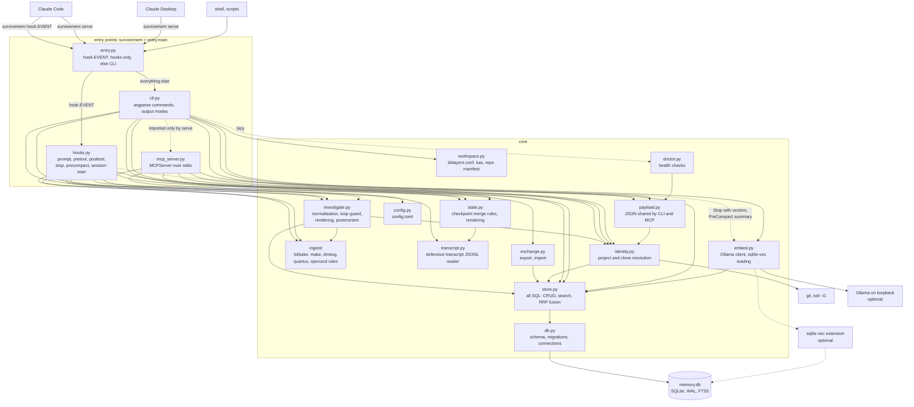

# Architecture

survivemem is one Python package with one console script, `survivemem`. The same
binary serves three audiences:

- **Claude Code hooks**: `survivemem hook <event>`, a short-lived process per hook
  event that reads a JSON payload on stdin and prints context on stdout;
- **MCP clients** (Claude Code, Claude Desktop): `survivemem serve`, an MCP server over
  stdio, one process per client session;
- **people and scripts**: every other subcommand, with human and JSON output.

All three open the same SQLite file directly (Profile A). Profile B puts one daemon in
front of the file instead; see [deployment.md](deployment.md).

## Components

Solid arrows are imports and calls on every run; dashed arrows are lazy imports or
optional paths.

| Module | Responsibility |
|---|---|
| `entry.py` | console entry point: platform check; `hook <event>` imports only `hooks.py`, everything else goes to the CLI |
| `cli.py` | argument parsing, one function per command, exit codes; command output goes through `output.py` |
| `hooks.py` | the six hook handlers and the hook boundary (`hooks.run`) |
| `mcp_server.py` | the twelve MCP tool functions, their descriptions, domain-error mapping |
| `identity.py` | collects identities from git, resolves the project (with a read-only fallback), records the clone, renders the clone line and scope suffixes |
| `investigate.py` | investigations: command normalisation, anchors, loop guard and loop detection, the investigation block, environment snapshot, close and pitfall distillation, evidence attachment, bisect table, postmortem |
| `ingest/` | deterministic log extraction, one module per tool family ([investigations.md](investigations.md#log-extraction-ingest-log)) |
| `workspace.py` | reads `conf/bblayers.conf`, `kas*.yml` and `.repo/manifest.xml` for `projects autodetect` |
| `store.py` | every SQL statement (memories, projects, clones, session state, investigations), as module-level constants with bound parameters; search and Reciprocal Rank Fusion |
| `db.py` | schema scripts, migrations, backups before migrating, connection setup (WAL, read-only fallback), ULIDs |
| `state.py` | checkpoint merge rules, secret redaction of transcript text, the `<survivemem-state>` rendering |
| `transcript.py` | reads the tail of Claude Code's transcript JSONL, skipping anything it does not recognise |
| `payload.py` | JSON objects shared by `--json` output and MCP results (projects, status, brief, integration checks) |
| `exchange.py` | JSONL and Markdown export, idempotent import |
| `doctor.py` | integrity, schema, FTS, filesystem, config, vector, Ollama, hook/MCP registration, name and clone checks; stale anchors |
| `embed.py` | loopback-only Ollama client (embeddings, compaction summaries), `sqlite-vec` loading |
| `config.py`, `paths.py` | `config.toml` parsing and validation; XDG path resolution |
| `model.py`, `output.py`, `schema.py` | row dataclasses and JSON conversion; table/Markdown/JSON rendering; JSON Schema document |
| `redact.py`, `logfile.py` | secret patterns; file logging for hooks and the MCP server |
| `families.toml` | root commits of well-known upstreams ([identity.md](identity.md#families)) |

### Import discipline

Hooks run on every prompt and every Bash call, so the hook path imports as little as
possible:

- `survivemem hook <event>` starts in `entry.py`, which imports `hooks.py` directly and
  never builds the CLI parser.
- The MCP SDK is imported only by `mcp_server.py`, which `cli.py` imports only inside
  `survivemem serve`. No hook loads it.
- `httpx` is imported only by `embed.py`. The prompt, SessionStart, PreToolUse and
  PostToolUse hooks never load it. The Stop hook loads it only when the `memory_vec`
  table exists (vector search was enabled), and the PreCompact hook only when
  `[compaction] summarize = true`.
- The package version (`importlib.metadata`) is looked up only by `--version` and
  `serve`.

On a database with 10 000 memories the whole prompt-hook process takes about 60 ms,
and the PreToolUse hook about 45 ms when no investigation is open (one SQLite query,
no `git` call).

### Error boundaries

Exactly two places catch every exception: `hooks.run()` and `survivemem serve`. Both
log the traceback to `hooks.log` and exit 0, so Claude Code never sees a failing hook
or a crashed server. Inside the MCP server, domain errors (invalid input, unknown id,
ambiguous prefix, database or config errors) are returned to the client as tool errors
carrying their message ([mcp.md](mcp.md#an-mcp-tool-call)). The CLI maps the same errors
to exit codes 1 to 4.

## Deployment: Profile A (native)

```mermaid
flowchart TB
    subgraph host["Linux workstation, single user"]
        subgraph claude["Claude Code process"]
            sess["session in a project directory"]
        end
        subgraph children["survivemem processes"]
            hookp["survivemem hook EVENT<br/>one short-lived process per hook event"]
            serve["survivemem serve<br/>one per session, MCP over stdio"]
            clip["survivemem CLI<br/>started by the user"]
        end
        subgraph files["local filesystem, XDG paths"]
            dbf[("~/.local/share/survivemem/memory.db<br/>plus -wal and -shm files")]
            cfgf["~/.config/survivemem/config.toml"]
            logf["~/.local/state/survivemem/hooks.log"]
            ccset["~/.claude/settings.json<br/>~/.claude.json"]
        end
        ollama["Ollama on 127.0.0.1:11434<br/>optional"]
    end
    sess -->|"spawn, payload on stdin,<br/>stdout added to context"| hookp
    sess -->|"spawn, JSON-RPC on stdin and stdout"| serve
    sess -.->|"reads hook and MCP registration"| ccset
    hookp -->|"read, write"| dbf
    serve -->|"read, write"| dbf
    clip -->|"read, write"| dbf
    hookp -->|"read"| cfgf
    serve -->|"read"| cfgf
    clip -->|"read"| cfgf
    hookp -->|"log"| logf
    serve -->|"log"| logf
    clip -.->|"status, doctor read"| ccset
    hookp -.->|"Stop, PreCompact, when enabled"| ollama
    serve -.->|"query embeddings"| ollama
    clip -.->|"search, reindex, status, doctor"| ollama
```

- Claude Code spawns `survivemem hook <event>` for each registered hook event and
  waits for it (5 s timeout, 30 s for PreCompact, as configured in
  [`settings.json`](settings.json)). Nothing stays resident between prompts.
- Claude Code spawns `survivemem serve` once per session; its working directory is
  the directory Claude Code was started in, which is how the server knows the project.
  Claude Desktop spawns it the same way but runs no hooks.
- Hooks, the MCP server and the CLI are all writers. They share the database through
  WAL mode and a 5 s busy timeout. The MCP server opens a fresh connection for every
  tool call, because the SDK may run synchronous tools in worker threads and an SQLite
  connection must not be shared between threads.
- The database must be on a local filesystem (ext4, xfs, btrfs, tmpfs, …). WAL locking
  is unreliable on NFS, CIFS, sshfs and 9p; `survivemem doctor` fails there.
- Logs go to `hooks.log` because stdout belongs to the hook contract and to the MCP
  protocol.
- The only network peer is an optional Ollama on loopback. Non-loopback Ollama URLs are
  refused.

Profile B (a long-lived daemon in a container, MCP over loopback HTTP, hooks as thin HTTP
clients) is described with its own deployment and sequence diagrams in
[deployment.md](deployment.md); `survivemem doctor` reports which profile is active.
