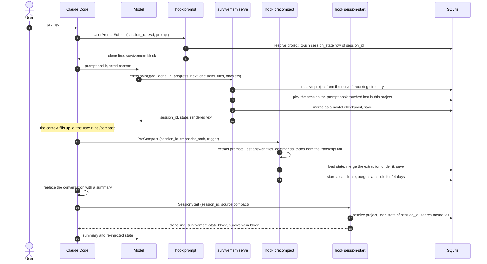
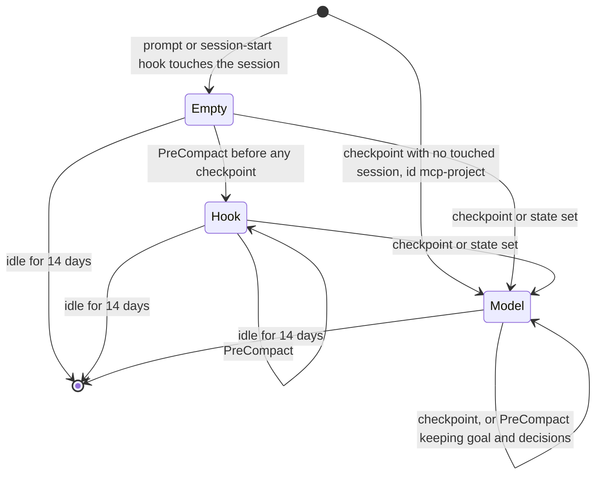

# Compaction resilience

`/compact` and auto-compaction replace the conversation with a summary. The summary
regularly drops the current goal, the decisions already taken and the list of open
items, and the model then repeats work or contradicts itself.

survivemem keeps that working state in SQLite instead of in the context window and
puts it back right after a compaction. Two channels are involved:

| Channel | What | When it reaches the model |
|---|---|---|
| long-term memories | facts, decisions, pitfalls, … (`memories` table) | every prompt (`UserPromptSubmit` hook), relevance-ranked |
| session state | goal, progress, next steps, decisions, files of *this* session (`session_state` table) | after a compaction or resume (`SessionStart` hook) |

Session state is not long-term memory: it is never searched, never exported, and
purged after 14 days without activity.

## The round trip



1. The prompt hook marks the Claude Code session as the most recently active session
   of the project (`touch_session`).
2. The model calls the MCP tool `checkpoint` after each completed subtask. MCP servers
   are not told the Claude Code session id, so the tool writes to the session the prompt
   hook touched last *in the same project*. The model calls `checkpoint` while answering
   the latest prompt, so this is the right session even with several sessions open in one
   project, as long as they do not prompt at the same moment.
3. When compaction starts, the PreCompact hook extracts what it can from the transcript
   without any LLM and merges it *under* the model's checkpoint: the model's goal and
   decisions always win. This covers a model that forgot to checkpoint.
4. After compaction, the SessionStart hook (matcher `compact|resume`) prints the clone
   line, the rendered `<survivemem-state>` and up to 8 long-term memories chosen for the
   goal and next steps.

`--resume` reuses the same session id, so the state carries over to a resumed session
too.

Without any hook-touched session (for example under Claude Desktop, which has no
hooks), `checkpoint` and `session_state` use a stable per-project id,
`mcp-<project id>` or `mcp-global`. The state still round-trips between calls, but
nothing re-injects it automatically; the model has to call `session_state` itself.

## Checkpoint fields

`session_state.state` is a JSON object:

```json
{
  "goal": "UART console bring-up on de10-nano",
  "done": ["enabled uart0 in the device tree"],
  "in_progress": "probe failure of altera_uart",
  "next": ["check the clock in socfpga.dtsi"],
  "decisions": ["stay on 6.6 LTS: vendor BSP breaks on 6.12"],
  "files": ["arch/arm/boot/dts/socfpga_cyclone5_de10_nano.dts"],
  "blockers": [],
  "source": "model",
  "recent_prompts": ["why does altera_uart fail to probe?"],
  "last_answer": "The clock is not enabled before the probe …",
  "commands": ["make -j8 zImage dtbs"],
  "summary": "…"
}
```

| Field | Written by | Meaning |
|---|---|---|
| `goal` | model; hook only when empty | one sentence |
| `done`, `next` | model; hook from the last `TodoWrite` list | lists of steps |
| `in_progress` | model; hook from the last `TodoWrite` list | current step |
| `decisions` | model only | decision plus a one-line reason |
| `files` | model and hook, merged | paths touched, newest first, at most 30 |
| `blockers` | model only | what stops progress |
| `source` | both | `model` once any model checkpoint was saved, otherwise `hook` |
| `recent_prompts` | hook | last 3 typed prompts, 300 chars each |
| `last_answer` | hook | last assistant text, 600 chars |
| `commands` | hook | last 10 `Bash` command lines |
| `summary` | hook, optional | 10-line summary from a local Ollama model, only with `[compaction] summarize = true` |

The hook-written fields give the model the recent conversation back even when it
never called `checkpoint`.

## Merge rules

Both merges live in `state.py`.

| Field | Model checkpoint (MCP `checkpoint`, `survivemem state set`) | PreCompact heuristic |
|---|---|---|
| `goal` | replaced | set only when empty: the oldest of the last 3 prompts, 200 chars |
| `decisions` | replaced | never touched |
| `done`, `in_progress`, `next` | replaced | replaced from the last `TodoWrite` list, when the transcript has one |
| `blockers` | replaced when given | never touched |
| `files` | union, newest first, at most 30 | union, newest first, at most 30 |
| `recent_prompts`, `last_answer`, `commands` | kept | replaced |
| `summary` | kept | replaced when summaries are enabled |
| `source` | `model` | `hook`, unless it already was `model` |

"Replaced" means: what the caller states overwrites the stored value. The MCP
`checkpoint` tool requires `goal`, `done`, `in_progress`, `next`, `decisions` and
`files` (empty values are allowed and clear the field), and takes `blockers`
optionally. `survivemem state set` only replaces what its flags name; repeated
`--done`, `--next`, `--decision` and `--blocker` flags build the new list, `--file` is
merged.

## Rendering

`<survivemem-state>` is terse: headings and bullets, no prose, at most 3 000
characters including the tags. Sections appear in priority order, so the budget cuts
the least important ones first; a heading is never left without an item.

| Section | Field | Max chars per item |
|---|---|---|
| `GOAL` | `goal` | 200 |
| `IN PROGRESS` | `in_progress` | 200 |
| `BLOCKERS` | `blockers` | 200 |
| `NEXT` | `next` | 200 |
| `DECISIONS` | `decisions` | 200 |
| `SUMMARY` | `summary` | 1 200 |
| `DONE` | `done` | 200 |
| `FILES` | `files` | 200 |
| `RECENT COMMANDS` | `commands` | 200 |
| `RECENT PROMPTS` | `recent_prompts` | 300 |
| `LAST ANSWER` | `last_answer` | 600 |

```
<survivemem-state>
GOAL: UART console bring-up on de10-nano
IN PROGRESS: probe failure of altera_uart
NEXT:
- check the clock in socfpga.dtsi
DECISIONS:
- stay on 6.6 LTS: vendor BSP breaks on 6.12
FILES:
- arch/arm/boot/dts/socfpga_cyclone5_de10_nano.dts
</survivemem-state>
```

Values read back from the database are narrowed to strings and lists of strings, so a
hand-edited state cannot break rendering.

## Lifecycle of a session state



Every prompt, checkpoint and compaction refreshes the row's `updated_at`, so an active
session is never purged. Old rows are removed by the PreCompact and SessionStart hooks
and by `survivemem state purge`.

## Using it

From the model, through MCP:

- `checkpoint(goal, done, in_progress, next, decisions, files, blockers?)` after every
  completed subtask and before any long operation;
- `session_state()` returns the current state and its rendering, or `{}`.

From a shell or a script:

```sh
survivemem state show                    # current session of this project
survivemem state show --session <id>     # any session
survivemem state set --goal "UART bring-up" --next "check the clock" \
    --decision "stay on 6.6 LTS: BSP breaks on 6.12" --file arch/arm/boot/dts/x.dts
survivemem state purge --yes             # states idle for more than 14 days
survivemem state purge --all --yes       # every state
```

"Current session" means the same thing for the CLI as for the MCP server: the session
the prompt hook touched last in this project, or `mcp-<project>` when there is none.
