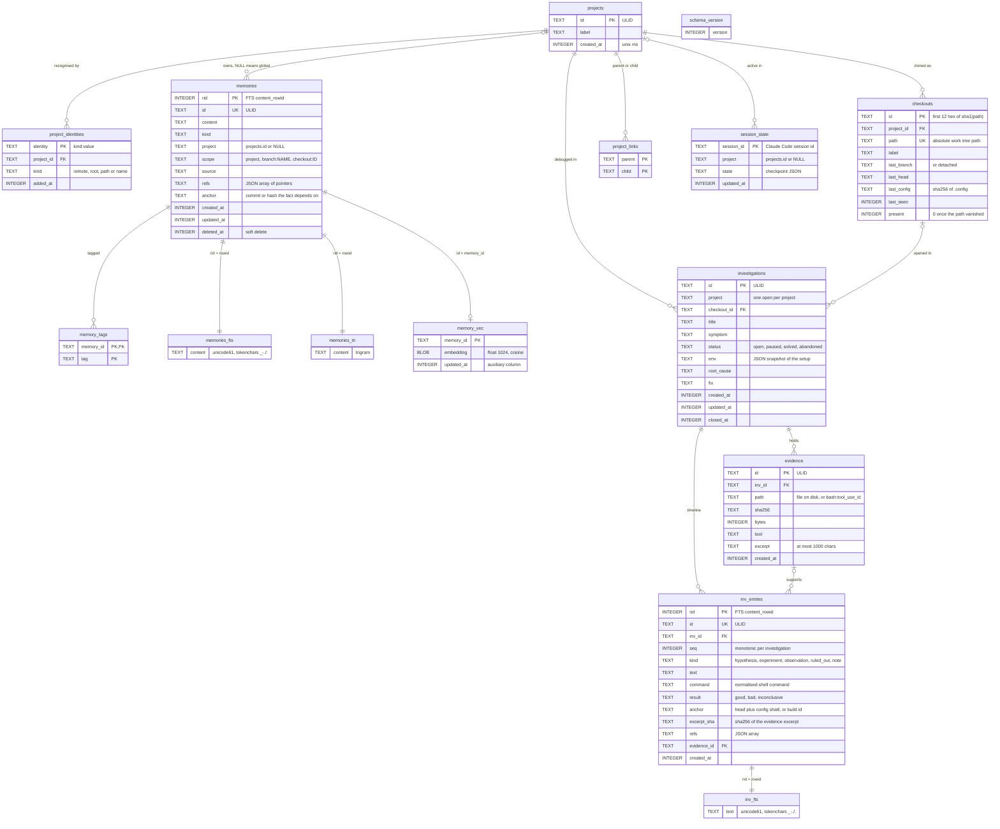
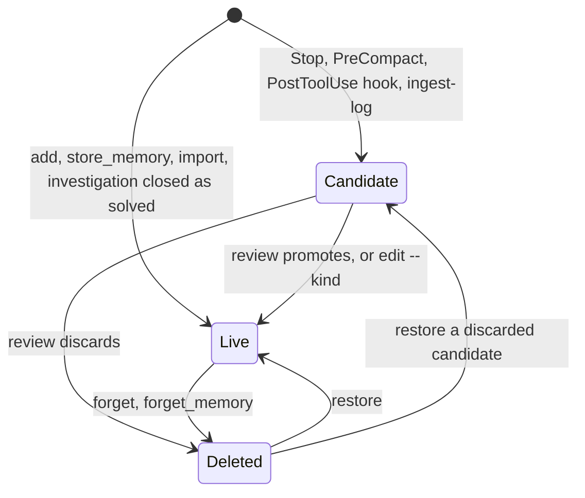

# Data model

Everything lives in one SQLite file, by default
`~/.local/share/survivemem/memory.db` (see [README](../README.md#files-and-paths)).
The schema is created and upgraded by numbered migrations in `src/survivemem/db.py`.
This page describes schema v1 (long-term memory, projects, clones), v2 (session
state) and v3 (investigations, see [investigations.md](investigations.md)).

## Entities

All timestamps are Unix milliseconds. `foreign_keys=ON` enforces the declared
references (`project_identities.project_id`, `checkouts.project_id`,
`memory_tags.memory_id`). `memories.project`, `session_state.project` and
`project_links` hold project ids without a declared foreign key; `projects merge`
rewrites all of them.

### `memories`

| Column | Values |
|---|---|
| `kind` | `fact`, `preference`, `project`, `decision`, `environment`, `pitfall`, `candidate` |
| `source` | `cli`, `mcp`, `hook` (Stop, PreCompact and failed-command candidates), `tool` (MCP tool captures, `ingest-log`), `import`, `investigation` (pitfalls written when an investigation is closed as solved) |
| `scope` | `project` (default), `branch:<name>`, `checkout:<id>`; see [identity.md](identity.md#scopes) |
| `project` | owning project, or NULL for a global memory visible everywhere |
| `refs` | JSON array of pointers to the source, never the source itself |
| `anchor` | free text: a git commit, a file hash, a layer revision the fact depends on |

`refs` entries are validated on every write; an unknown `type` or a missing required
key is rejected:

| `type` | Required key | Example |
|---|---|---|
| `symbol` | `path` | `{"type":"symbol","tool":"jcodemunch","path":"drivers/clk/foo.c","symbol":"foo_probe","commit":"1f2e…"}` |
| `doc` | `doc_id` | `{"type":"doc","tool":"rag","doc_id":"cv_5v4","chunk":412}` |
| `file` | `path` | `{"type":"file","path":"meta-foo/recipes-kernel/linux/linux-foo_6.6.bb","sha256":"…"}` |
| `investigation` | `id` | `{"type":"investigation","id":"01JB…"}` |
| `url` | `url` | `{"type":"url","url":"https://…"}` |

`survivemem show <id>` prints refs as copy-pasteable commands where it can
(`git show <commit>:<path>` for a symbol or file with a commit).

### `rid` and `id`

Every memory has two keys:

- `id` is a [ULID](https://github.com/ulid/spec): 26 Crockford base32 characters, a
  48-bit millisecond timestamp followed by 80 random bits, generated with the standard
  library. It is what users, exports and MCP tools see. Every command accepts any
  unique prefix (`survivemem show 01JB`); an ambiguous prefix exits with code 4.
- `rid` is an explicit `INTEGER PRIMARY KEY`, used only as the full-text indexes'
  `content_rowid`. An implicit `rowid` may be renumbered by `VACUUM`, which would
  silently detach the indexes from their rows; an explicit integer primary key is
  never renumbered.

### Full-text indexes

`memories_fts` and `memories_tri` are FTS5 *external-content* tables: they store only
the index, and read the text from `memories.content` by `rid`. Three triggers keep them
in sync:

| Trigger | Fires on | Effect on both indexes |
|---|---|---|
| `memories_ai` | `AFTER INSERT` | index the new row |
| `memories_ad` | `AFTER DELETE` | remove the old row |
| `memories_au` | `AFTER UPDATE OF content` | remove the old text, index the new text |

- `memories_fts` uses `unicode61` with `tokenchars '_-./:'`, so technical identifiers
  stay whole: `CONFIG_ARM64_PTR_AUTH`, `do_rootfs`, `de10-nano`, `linux-6.6.y`,
  `arm/boot/dts`, `0xFF200000`, `socfpga_cyclone5_de10_nano.dts`.
- `memories_tri` uses the `trigram` tokenizer and finds substrings inside identifiers
  (`PTR_AUTH`). Search consults it only when the token index returns fewer than three
  hits.

`survivemem reindex` rebuilds both; `survivemem doctor` runs FTS5's integrity check
on both and reports drift.

### `memory_vec` (optional, created on demand)

`memory_vec` is not part of any migration. `survivemem reindex` creates it, as a
`sqlite-vec` `vec0` virtual table with 1 024-dimensional float embeddings and cosine
distance, only when the `sqlite-vec` extension loads and a loopback Ollama returns
embeddings. Every statement that touches it needs the extension loaded on that
connection.

The auxiliary `updated_at` column records which version of a memory was embedded. A
memory whose `updated_at` is newer than its vector is re-embedded (by the Stop hook, up
to 16 at a time, or by `reindex`), so editing a memory never has to touch `memory_vec`.

### `session_state` (schema v2)

One row per Claude Code session: the working state that must survive a compaction
(see [compaction.md](compaction.md)). `state` holds the checkpoint JSON. The index on
`(project, updated_at)` answers "which session of this project was active last", which
is how the MCP `checkpoint` tool finds its session. Session state is never searched,
never exported, and purged 14 days after its last update.

### `project_links`

Workspace links (parent and child projects, for multi-repo layouts such as Yocto
layers). Memories of linked projects are visible from each other. Links are created
with `survivemem projects link` or `projects autodetect`
([identity.md](identity.md#workspaces)).

### Investigations (schema v3)

- `investigations`: one row per debug session. A partial unique index on
  `investigations(project) WHERE status = 'open'` makes "one open investigation per
  project" a database rule. `env` is the JSON snapshot of the setup taken at open
  (environment memories, the head of each workspace repo, free text). `checkout_id`
  records the clone it was opened in.
- `inv_entries`: the append-only timeline. `seq` is allocated inside the inserting
  transaction, so it stays monotonic even with hooks and CLI writing at once. Like
  `memories`, it has an explicit `rid` used as the `content_rowid` of `inv_fts`, kept
  in sync by insert/delete/update triggers. `(inv_id, command)` is indexed for the loop
  guard, which looks a command up on every Bash call while an investigation is open.
- `evidence`: a pointer (a file path, or `bash:<tool_use_id>` for output captured by the
  PostToolUse hook), sha256, size, tool and an excerpt of at most 1 000 characters.
  Files stay on disk; at most 200 MB per investigation.

Investigations are moved by `projects merge` along with everything else.

## Memory lifecycle

**Soft delete.** `forget` (and the MCP `forget_memory`, and discarding in `review`)
sets `deleted_at`; `restore` clears it, and the memory returns with the kind it had. No
command deletes memory rows. Because a soft delete is an `UPDATE` of `deleted_at`, not
of `content`, the full-text rows stay; every query joins back to `memories` and filters
`deleted_at IS NULL`. `survivemem show <id>` is the one command that also displays
deleted memories.

**Candidates are never searched.** Hooks capture candidates (`kind = 'candidate'`):
the last prompt and answer of a turn (Stop, PreCompact), failed debug commands outside
an investigation and digests of selected MCP tool results (PostToolUse), and
`ingest-log` excerpts outside an investigation. Search, the prompt hook, the
SessionStart hook and every MCP read tool exclude them. `survivemem list` and `export`
leave them out unless asked with `--kind candidate`. They become ordinary memories only
through `survivemem review` (or an explicit `survivemem edit <id> --kind …`).

| Reader | Live | Candidates | Deleted |
|---|---|---|---|
| `search`, `search_memories`, prompt and SessionStart hooks | yes | no | no |
| `list`, `export`, `list_recent`, `brief` | yes | only with `--kind candidate` (`list`, `export`) | no |
| `review` | no | yes | no |
| `show` | yes | yes | yes |

## Migrations and connections

- `schema_version` holds a single integer. Each migration is a function; pending ones
  run in order, each in its own `BEGIN IMMEDIATE` transaction together with the version
  bump.
- A database newer than the installed code is refused (`database schema vN is newer
  than this survivemem vM`, exit code 3) instead of being written to.
- Before migrating a populated database, it is copied with SQLite's online backup API
  to `memory.db.bak-<old version>` next to it. An existing backup of the same version is
  kept, not overwritten. Downgrading means restoring that file.
- Migrations run on the first connection after an upgrade, whichever process opens the
  file first: a hook, the CLI or the MCP server.
- Every writable connection sets `journal_mode=WAL`, `synchronous=NORMAL`,
  `foreign_keys=ON` and `busy_timeout=5000`, so hooks, the CLI and the MCP server can
  share the file. WAL needs a local filesystem; `survivemem doctor` fails on NFS, CIFS,
  sshfs, 9p and AFS.
- A read-only file (or one in a read-only directory) is opened with `mode=ro`, falling
  back to `immutable=1` when `mode=ro` cannot read it (a WAL database in a directory
  where no `-shm` file can be created). It must already be at the current schema
  version; it is never migrated. Reads work, writes fail with
  `attempt to write a readonly database`.

## JSON representation

`--json` output, exports and MCP results use the column names above, plus:

- an `*_iso` string (UTC, ISO 8601) next to every timestamp;
- `tags` as a sorted list;
- `project_label` (`global` for project-less memories);
- for search hits: `score` (fused RRF score), `matched_by` (`fts`, `trigram`, `vec`),
  and `bm25` / `vec_distance` when available.

`survivemem schema` prints the JSON Schema (draft 2020-12) of the memory, project,
checkout, checkpoint and ref objects.
