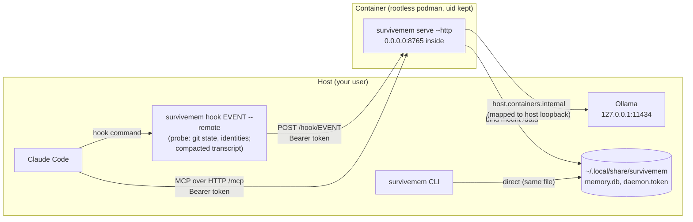
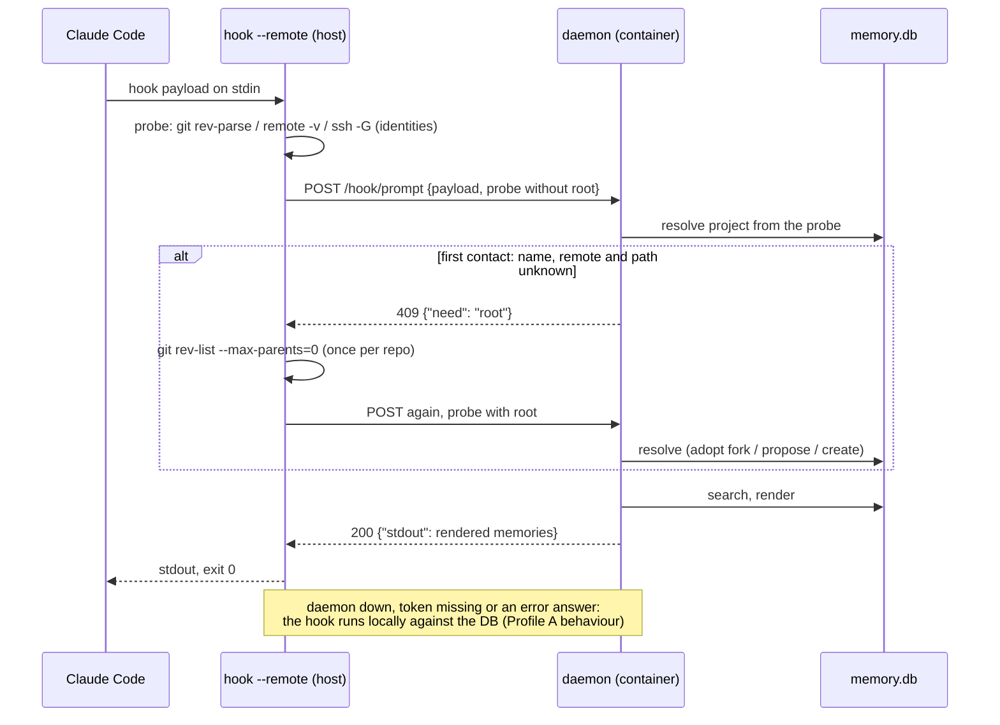

# Deployment profiles

survivemem runs in one of two profiles. Both use the same code and the same database
file; they differ in who opens the file and how hooks reach it.

| | Profile A — native (default) | Profile B — daemon |
|---|---|---|
| MCP transport | stdio, one `survivemem serve` per Claude Code session | Streamable HTTP at `http://127.0.0.1:8765/mcp`, one long-lived process |
| Hooks | `survivemem hook <event>` opens the DB | `survivemem hook <event> --remote` posts to the daemon |
| DB writers | hooks, CLI, MCP server (WAL, `busy_timeout`) | the daemon; with the Quadlet bind mount the host CLI too |
| Typical use | one workstation | a reproducible image, a DB kept off a network home directory, one daemon for several tools |

Profile A needs nothing beyond [the README setup](../README.md#claude-code-setup). The rest
of this page is about Profile B.

## Profile B at a glance



The port is published to the host's `127.0.0.1:8765` only. Inside its own network
namespace the daemon listens on `0.0.0.0`; outside a container it refuses any
non-loopback bind unless `SURVIVEMEM_ALLOW_REMOTE=1` (unsupported).

## What a remote hook does

The daemon cannot see your repositories or Claude Code's transcripts, so the client sends
what resolution and the hooks need:



- Identities are computed on the client, with your SSH configuration (`ssh -G` aliases)
  and your `[identity.hosts]` map, so host and daemon never disagree about a remote.
- `Stop` and `PreCompact` add the transcript tail, stripped to what the hooks read
  (typed prompts, assistant text, tool calls with `file_path`/`command`/`todos`); tool
  results, thinking and file contents are not sent.
- The client uses `http.client` from the standard library and never imports the MCP SDK:
  a remote prompt hook takes about 60 ms, the daemon's part about 1.5 ms.

## Setup with rootless Podman (Quadlet)

```sh
podman build -t localhost/survivemem:latest .
mkdir -p ~/.config/containers/systemd ~/.local/share/survivemem
cp deploy/survivemem.container ~/.config/containers/systemd/
systemctl --user daemon-reload
systemctl --user start survivemem
curl -s http://127.0.0.1:8765/health      # {"version": …, "schema_version": 3, "profile": "B"}
```

The unit bind-mounts `~/.local/share/survivemem` to `/data` with `UserNS=keep-id`, so the
database and `daemon.token` (mode 0600) stay owned by you and sit where the hook client
and the CLI look for them. On SELinux hosts keep the `:Z` suffix of the volume; drop it
on Arch and Debian.

Hooks: append ` --remote` to every `survivemem hook …` command in your
`~/.claude/settings.json` (see [`settings.json`](settings.json)). Set
`SURVIVEMEM_DAEMON_URL` if the daemon is not at `http://127.0.0.1:8765`.

MCP: register the HTTP endpoint with the bearer token (`-H`/`--header`, as listed by
`claude mcp add --help`):

```sh
claude mcp add --transport http --scope user survivemem http://127.0.0.1:8765/mcp \
    --header "Authorization: Bearer $(cat ~/.local/share/survivemem/daemon.token)"
```

`survivemem doctor` reports `profile B (daemon)` when hooks carry `--remote` or
`SURVIVEMEM_DAEMON_URL` is set, and warns when the daemon is unreachable or runs another
version than the client.

### Ollama from the container

Ollama listens on the host's `127.0.0.1`. Podman's `host.containers.internal`
(`169.254.1.2` with pasta) reaches the host's other addresses, not its loopback, so the
unit maps that address to the host loopback:

```ini
Network=pasta:--map-host-loopback,169.254.1.2
```

Inside a container the runtime's host aliases (`host.containers.internal`,
`host.docker.internal`) are accepted as Ollama hosts; anywhere else only loopback is.

## Docker / compose

[`deploy/compose.yaml`](../deploy/compose.yaml) runs the same image with a named volume,
which keeps the database off a network-mounted home directory. The host CLI then has to
run inside the container (`docker compose exec survivemem survivemem …`), and Ollama has
to listen on an address the container can reach.

## Security model

- Every request except `/health` needs `Authorization: Bearer <token>`. Loopback is
  reachable by every local user; the token file, like the database, is readable only by
  you.
- The MCP endpoint keeps the SDK's DNS-rebinding protection.
- Nothing leaves the machine: Ollama requests ignore `HTTP_PROXY`/`ALL_PROXY`.

## Limitations

- HTTP MCP clients do not send their working directory and the daemon has no repository
  around it, so MCP tools act on the project of the session the hooks saw last. Pass
  `project` to `search_memories` / `store_memory` to be explicit; `scope="branch"` and
  `scope="checkout"` need a local clone and are refused.
- The image is about 168 MB (target in the spec: 150 MB).
- Claude Desktop over HTTP is not verified; stdio (Profile A) is the known-good path.
