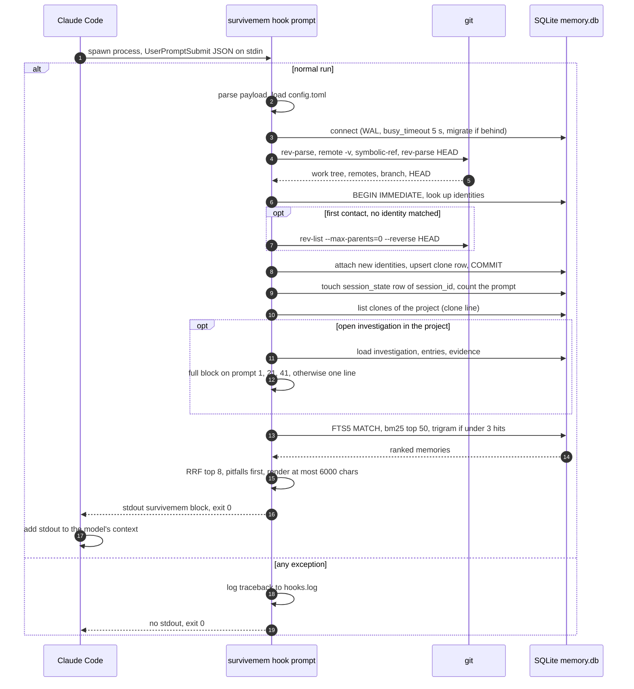
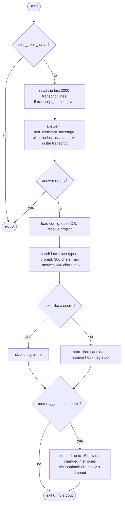
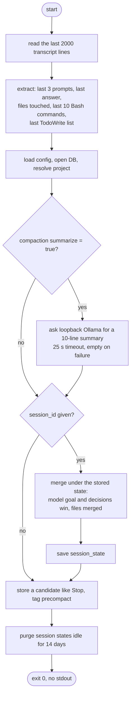
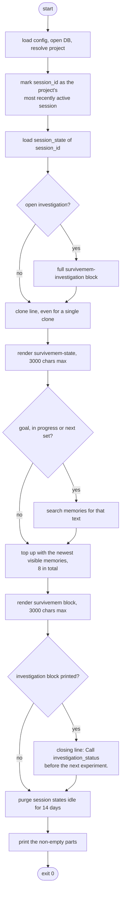
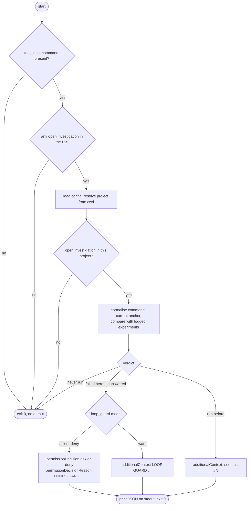
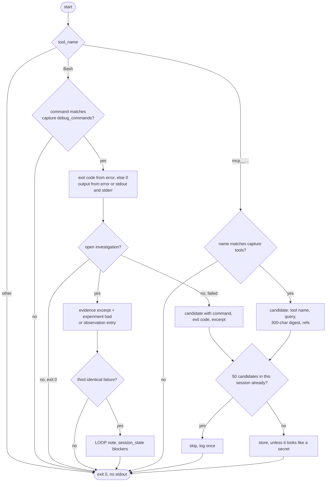

# Claude Code hooks

Every hook is the same binary: `survivemem hook <event>` reads the hook's JSON payload
on stdin. A hook never fails: errors are logged with a traceback to
`$XDG_STATE_HOME/survivemem/hooks.log` and the process exits 0. Hooks never import
the MCP SDK. The only network access in any hook is a loopback Ollama, and only when
you enabled it: the Stop hook calls it for embeddings when vector search is enabled
(`survivemem reindex` created `memory_vec`), the PreCompact hook for a summary when
`[compaction] summarize = true`.

`survivemem hook <event>` starts in a small entry module that imports only the hook
code, not the CLI and its parser: hooks run on every prompt and every tool call.

Install by merging [`settings.json`](settings.json) into `~/.claude/settings.json`
(all projects) or `.claude/settings.json` (one project).

| Event | Matcher | Command | Timeout |
|---|---|---|---|
| `UserPromptSubmit` | | `survivemem hook prompt` | 5 s |
| `PreToolUse` | `Bash` | `survivemem hook pretool` | 5 s |
| `PostToolUse` | `Bash\|mcp__.*` | `survivemem hook posttool` | 5 s |
| `PostToolUseFailure` | `Bash` | `survivemem hook posttool` | 5 s |
| `Stop` | | `survivemem hook stop` | 5 s |
| `PreCompact` | | `survivemem hook precompact` | 30 s |
| `SessionStart` | `compact\|resume` | `survivemem hook session-start` | 5 s |

## `UserPromptSubmit` → `survivemem hook prompt`

Resolves the project from `cwd`, records the current clone, and prints on stdout
(Claude Code adds it to the context):

- one line naming this clone and the other clones of the project, when more than one
  exists on disk:
  `linux · this clone ~/w/linux-de10 @socfpga-6.6 (abc1234, .config 9f3e…) · others: ~/w/linux-up @master`
- on first contact with a fork that was not merged automatically (a fork of a
  `families.toml` upstream such as the kernel or U-Boot, or any fork with
  `root_match = "propose"`), a hint with the `survivemem projects alias add` command that
  would merge them;
- up to 8 relevant memories, ≤ 400 characters each, ≤ 6 000 characters in total:

```
<survivemem>
- [decision] Kernel pinned to 6.6 LTS; vendor BSP breaks on 6.12. (01JB4K2Q)
- [environment] /dev/ttyUSB1=de10-nano-uart [clone linux-de10] (01JB4M7A)
</survivemem>
```

Nothing is printed when nothing is relevant. When the prompt looks like an error
(`ERROR`, `failed`, `Oops`, `panic`, `timing`, `slack`, `Critical Warning`,
`Error (`, `Fitter`), `pitfall` memories are ranked first. FTS5 only, no embedding
call; on a DB with 10 000 memories the whole process takes about 60 ms.

The prompt hook also records the session id as the most recently active session of the
project; the MCP `checkpoint` tool writes to that session.

When the project has an open [investigation](investigations.md), the prompt hook also
prints it before the memories:

- on the first prompt of a session and on every 20th prompt after it (prompts 1, 21,
  41, …; the counter lives in `session_state`), the full
  `<survivemem-investigation>` block (at most 2 500 characters);
- on every other prompt, one line, plus the blocker while one is active:

```
investigation 01M68MXAW3HW7RSCSKE2GEZQD0 "altera_uart probe fails" open — call investigation_status for details
BLOCKER   LOOP: make -j8 dtbs failed identically ×3 — #4, #5, #6
```

It also removes a `LOOP:` blocker from the session's checkpoint once a hypothesis has
answered it. The investigation text counts against the 6 000-character budget.

A read-only DB file still works: the project is looked up without writing, nothing
new is recorded. Without `git` on `PATH` only global memories are injected.

### Activity

```mermaid
flowchart TD
    start([start]) --> read["read JSON payload from stdin"]
    read --> cfg["load config.toml<br/>invalid: defaults, error logged"]
    cfg --> open["open DB: WAL, migrate if needed"]
    open --> resolve["resolve project from payload cwd<br/>record the clone"]
    resolve --> refused{"DB write refused?"}
    refused -->|yes| lookup["read-only lookup, nothing recorded"]
    refused -->|no| touch
    lookup --> touch["mark session_id as the project's most recently<br/>active session, count this prompt"]
    touch --> head["clone line if more than one clone on disk<br/>root-commit hint on first contact"]
    head --> inv{"open investigation in the project?"}
    inv -->|no| hasprompt
    inv -->|yes| nth{"1st prompt of the session,<br/>or 21st, 41st, …?"}
    nth -->|yes| full["full survivemem-investigation block"]
    nth -->|no| oneline["one-line reminder,<br/>plus BLOCKER while one is active"]
    full --> hasprompt
    oneline --> hasprompt{"prompt empty?"}
    hasprompt -->|yes| printhead["print clone line, hint and<br/>investigation lines, if any"]
    hasprompt -->|no| terms["query terms: lowercased, stopwords dropped,<br/>at most 32, matched as prefixes"]
    terms --> fts["FTS5 bm25 top 50: live, non-candidate,<br/>own + linked + global projects, current scopes"]
    fts --> few{"fewer than 3 hits?"}
    few -->|yes| tri["add trigram substring hits"]
    few -->|no| rrf
    tri --> rrf["Reciprocal Rank Fusion, top 8"]
    rrf --> errlike{"prompt looks like an error?"}
    errlike -->|yes| pit["rank pitfall memories first"]
    errlike -->|no| render
    pit --> render["render lines of at most 400 chars until 6000 chars<br/>incl. clone line, hint and investigation"]
    render --> print["print to stdout"]
    print --> done(["exit 0"])
    printhead --> done
```



The search is lexical only: English and Polish stopwords are dropped, so a prompt made
only of filler words injects nothing. Query terms of three or more characters are
matched as prefixes, because the tokenizer keeps `.` and `:` inside tokens (`LTS.` at
the end of a sentence is indexed as `lts.`). Trigram hits catch substrings inside
identifiers (`PTR_AUTH` in `CONFIG_ARM64_PTR_AUTH`) and are only consulted when the
token search finds fewer than three memories.

### One prompt, end to end



Each hook is a short-lived process; nothing stays resident between prompts. Remotes
reached over SSH cost one `ssh -G` call each per run (reads `~/.ssh/config`, no
connection). The full `git rev-list` walk runs only on first contact with a clone.

The boundary is `hooks.run()`: any exception (a malformed payload, a write refused
by a read-only DB in the Stop or PreCompact hook, a bug) is logged with its traceback
to `$XDG_STATE_HOME/survivemem/hooks.log`, and the process exits 0 with no output.
Claude Code never sees a failing hook.

## `Stop` → `survivemem hook stop`

Stores the last prompt (≤ 300 chars) and the final answer (≤ 600 chars) as one
`candidate` memory. The final answer comes from `last_assistant_message`; the
prompt from the tail of the transcript, skipping tool calls, tool results, thinking
and subagent entries. Candidates are never searched or injected: promote them with
`survivemem review`. Nothing is stored when `stop_hook_active` is true or when the
text looks like it contains a secret.



Embeddings are computed here, after the answer, never in the prompt hook. The step is
skipped unless vector search was enabled with `survivemem reindex`; it is the only
place a hook loads `httpx` besides the optional PreCompact summary below, and both
only ever contact a loopback Ollama.

## `PreCompact` → `survivemem hook precompact`

The deterministic fallback for a model that forgot to call `checkpoint`. From the tail
of the transcript it extracts the last 3 prompts (≤ 300 chars), the last answer
(≤ 600 chars), the files touched by `Edit`/`Write`/`Read` (newest first, ≤ 30), the last
10 `Bash` commands and the last `TodoWrite` list (all text passed through the secret
redaction), and merges them into the session's state: the model's goal and decisions
always win, files are merged, todos refresh
done / in progress / next. It also stores a candidate like the Stop hook, and purges
session states older than 14 days. It never blocks compaction.



The optional summary (`[compaction] summarize = true`, model `[compaction] model`,
default `llama3.2`) fits inside the 30 s PreCompact timeout; on any failure the
deterministic state is saved without it. The merge rules are listed in
[compaction.md](compaction.md#merge-rules).

## `SessionStart` (matcher `compact|resume`) → `survivemem hook session-start`

Right after a compaction or a resume, prints:

0. when the project has an open [investigation](investigations.md), the **full**
   `<survivemem-investigation>` block first, never the one-liner: compaction summaries
   regularly drop the ruled-out list;
1. the clone line, even for a single clone (compaction loses the `cwd` context);
2. `<survivemem-state>` — the session's checkpoint, terse, ≤ 3 000 characters:

```
<survivemem-state>
GOAL: UART console bring-up on de10-nano
IN PROGRESS: probe failure of altera_uart
NEXT:
- check the clock in socfpga.dtsi
DECISIONS:
- stay on 6.6 LTS: vendor BSP breaks on 6.12
FILES:
- arch/arm/boot/dts/socfpga_cyclone5_de10_nano.dts
</survivemem-state>
```

3. `<survivemem>` — up to 8 long-term memories for the goal and next steps, topped up
   with the newest ones, ≤ 3 000 characters;
4. when an investigation block was printed, a closing line:
   `Call investigation_status before the next experiment.`

Nothing is printed when nothing is stored and the directory is not a project.



The handler does not look at the payload's `source`; the `compact|resume` matcher in
[`settings.json`](settings.json) decides when it runs. The full round trip with the
MCP `checkpoint` tool and the PreCompact hook is drawn in
[compaction.md](compaction.md).

## `PreToolUse` (matcher `Bash`) → `survivemem hook pretool`

The loop guard of [investigations](investigations.md#the-loop-guard-pretooluse). It
does nothing unless the project has an open investigation; the first check is a single
SQLite query with no `git` call, so the common case costs about 45 ms for the whole
process.



The output is the `hookSpecificOutput` JSON of the PreToolUse contract.
`permissionDecision` is only ever `ask` or `deny`; `warn` mode and the "seen as" note
add `additionalContext` and leave the decision to your normal permission settings,
because answering `allow` would skip the permission prompt for the command.

## `PostToolUse` / `PostToolUseFailure` → `survivemem hook posttool`

Captures debug commands and selected MCP tool results
([details](investigations.md#capture-and-loop-detection-posttooluse)). Registered for
`PostToolUse` with matcher `Bash|mcp__.*` and for `PostToolUseFailure` with matcher
`Bash`: `PostToolUse` fires only after a successful call, and a failed Bash call arrives
as `PostToolUseFailure` whose `error` reads `Exit code N` followed by the output. It
prints nothing.



Output excerpts are at most 1 000 characters and pass through the secret redaction;
full tool output and raw MCP results are never stored.

## Samples

[`samples/`](samples) holds example payloads for every event. Edit `cwd` to point at
one of your repositories, then replay one, for example:

```sh
survivemem hook prompt < docs/samples/user-prompt-submit.json
survivemem hook pretool < docs/samples/pre-tool-use.json
survivemem hook posttool < docs/samples/post-tool-use-failure.json
```

| File | Event |
|---|---|
| [`user-prompt-submit.json`](samples/user-prompt-submit.json) | `UserPromptSubmit` |
| [`pre-tool-use.json`](samples/pre-tool-use.json) | `PreToolUse` (Bash) |
| [`post-tool-use.json`](samples/post-tool-use.json) | `PostToolUse` (successful Bash: `tool_response` with `stdout`, `stderr`, `interrupted`, `isImage`) |
| [`post-tool-use-failure.json`](samples/post-tool-use-failure.json) | `PostToolUseFailure` (failed Bash: `error` = `Exit code N` + output) |
| [`stop.json`](samples/stop.json) | `Stop` |
| [`pre-compact.json`](samples/pre-compact.json) | `PreCompact` |
| [`session-start.json`](samples/session-start.json) | `SessionStart` (`source` = `compact`) |
