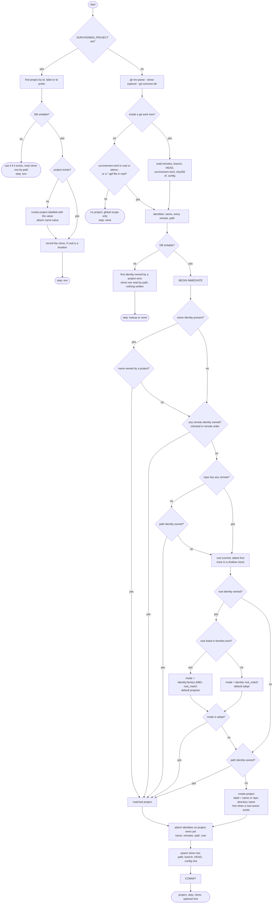
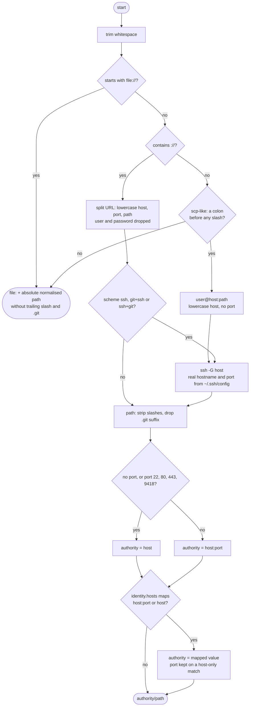

# Project identity

survivemem treats a repository as the same project wherever it is cloned: another
directory, another machine, a worktree, a fresh clone after `rm -rf`, or a fork with a
different remote URL. Memories stored with `project = X` are visible from every clone
of X. Two unrelated repositories that happen to share a directory name never collide.

Every hook, every MCP tool call and every CLI command that needs the current project
runs the same resolution (`identity.resolve`), starting from a working directory
(the hook payload's `cwd`, the MCP server's working directory, or `$PWD` for the CLI).

## Identities

A project is recognised by one or more *identities*, stored in the
`project_identities` table. Each identity belongs to exactly one project.

| Kind | Value | Where it comes from |
|---|---|---|
| `name` | `name:<project>` | `project = "<name>"` in `.survivemem.toml` at the repository root. Travels with the repo (fork, mirror, air-gapped copy). |
| `remote` | `remote:<normalised url>` | every remote from `git remote -v` (fetch URLs, after `insteadOf` rewriting), normalised as described [below](#remote-url-normalisation) |
| `root` | `root:<sha>` | the oldest root commit, `git rev-list --max-parents=0 --reverse HEAD`, first line. Computed only when no cheaper identity matched. |
| `path` | `path:<abs path>` | the git common directory (`git rev-parse --git-common-dir`), so all worktrees of one repository share it. Outside git, the directory holding `.survivemem.toml` or the `.qpf` file. |

Remotes are ordered: the remote named by `[identity] remote` (default `origin`) first,
then `upstream`, then the rest alphabetically. That order decides which remote wins
when several are owned by different projects, and which one appears in hints.

The *oldest* root commit is used, not the first in git's default order: repositories
gain new parentless commits when a subtree is squashed in (U-Boot has four roots), and
the oldest one does not change when that happens.

## Resolution



The first hit wins. The step that matched is reported by `survivemem projects here`
as `matched by: env | name | remote | path | root | created | lookup | none`.

**`SURVIVEMEM_PROJECT`** (a project label, id or unique id prefix) overrides
everything. When it names no project, one is created with that label and a
`name:<value>` identity.

**`.survivemem.toml` name.** When the repository root (or, outside git, `cwd` or any
parent) has a `.survivemem.toml` with `project = "<name>"`, a known name wins over
everything after it. A name that is not known yet is a miss: the remote, root and path
steps follow, and the name is attached to whichever project they find, so adding the
file to an existing repository does not split its memories off. A newly created project
is labelled with the name.

**Remote.** Any remote identity owned by a project matches. This is the normal
path for every clone after the first.

**Repository without remotes.** Its path is checked *before* the root commit:
`git rev-list` walks the whole history, and without a remote that walk would
otherwise run on every lookup. It now runs only on first contact.

**Root commit.** The root identity matches forks: different remote, same history.
What happens next depends on whether the root is a known upstream
([families](#families)):

- not listed in `families.toml`: **adopt** by default. The fork is the same project;
  its remote and path identities are attached silently. Your GitHub fork of a project
  shares memories with upstream.
- listed (Linux, U-Boot, Buildroot, openembedded-core/poky, TF-A, BusyBox):
  **propose** by default. Every kernel fork shares one root commit and vendor BSP
  forks are usually distinct projects, so a new project is created and the first
  output prints a hint:
  `root commit matches project linux — run: survivemem projects alias add <id> remote:<url>`

In propose mode the path is checked before creating a project, so a clone whose
remote URL changed stays in its project instead of splitting off.

**Path.** A repository that lost its remotes is still found by its git directory.

**Create.** Nothing matched: a project is created, labelled with the `.survivemem.toml`
name or the repository's directory name.

After any hit, identities that no project owns yet are attached to the matched project,
so the next lookup hits at the remote step and no `git rev-list` is needed. Identities
are never taken from another project automatically; `projects alias add --yes` does
that on request.

### Edge cases

- **Shallow clones** get no root identity. In a shallow clone the parentless commits
  are the depth boundary, which moves with every `--depth` or `fetch --deepen`. The
  repository is still identified by its remotes and path.
- **Read-only DB.** When the DB cannot be written (read-only file or directory), hooks,
  CLI and MCP server fall back to a lookup that writes nothing: the first identity owned
  by a project wins and the clone row is read by path. Memories are still injected and
  read commands work; writes fail.
- **`git` missing from `PATH`** or timing out (2 s per call, 3 s for the root-commit
  walk): checkouts are treated like plain directories, so only `.survivemem.toml` or a
  `.qpf` file names a project. Otherwise the project is unknown and only global
  memories are visible.
- **Worktrees** share the `path:` identity of their common git directory, but each
  worktree is its own clone row (its own branch, HEAD and `.config`).
- **Outside git**, a `.survivemem.toml` in `cwd` or any parent names the project; failing
  that, a Quartus project file (`*.qpf`) in `cwd` does, using its basename.

## Remote URL normalisation

All remote URLs go through one function, `normalise_remote_url`, so that the same
repository reached through different URL spellings produces the same identity.



Rules, in words:

- Scheme, credentials, default ports (22, 80, 443, 9418) and the `.git` suffix are
  dropped. The host is lowercased; the path keeps its case.
- A non-default port is kept: two services on one host with different ports may be
  different instances. GitLab sub-groups are part of the path and stay.
- SSH host aliases (`git@gl:grp/repo.git` with `Host gl` in `~/.ssh/config`) are
  resolved with `ssh -G gl`, which reads the configuration and makes no connection.
  An explicit port in the URL wins over the configured one. Aliases that do not look
  like host names (for example, ones starting with `-`) are not passed to `ssh`. If
  `ssh` is missing or fails, the alias is used as is.
- `[identity.hosts]` in `config.toml` rewrites an authority before comparison: an exact
  `host:port` key first, then a bare `host` key (the port, if kept, is re-appended).
  Keys are compared against the lowercased host.
- `file://` URLs and local paths become `file:<absolute path>`; relative paths are
  resolved against the repository root.

| Remote URL | Identity |
|---|---|
| `git@github.com:FPGArtktic/foo.git` | `remote:github.com/FPGArtktic/foo` |
| `https://user@github.com/FPGArtktic/foo.git/` | `remote:github.com/FPGArtktic/foo` |
| `ssh://git@github.com:22/FPGArtktic/foo` | `remote:github.com/FPGArtktic/foo` |
| `ssh://git@gitlab.lan:12345/grp/sub/repo.git` | `remote:gitlab.lan:12345/grp/sub/repo` |
| `https://GitLab.LAN/grp/repo.git` | `remote:gitlab.lan/grp/repo` |
| `file:///srv/git/repo.git` | `remote:file:/srv/git/repo` |
| `../mirror/repo.git` (repo at `/home/u/w/repo`) | `remote:file:/home/u/w/mirror/repo` |

The same repository reached over HTTPS and over SSH on an odd port gives two
different identities. They converge in one of three ways: an `[identity.hosts]`
entry, the root-commit step on first contact, or `survivemem projects alias add`.

`survivemem projects here` prints the raw URL, the resolved SSH alias and the
normalised identity side by side, so a mismatch is visible without reading code:

```
project   survivemem (01M68KH5J1Y4VEMAY1HAG3X8HQ)  matched by: remote
root      /home/u/git/survivemem
git dir   /home/u/git/survivemem/.git
remote    origin: https://github.com/FPGArtktic/survivemem.git  →  -  →  remote:github.com/FPGArtktic/survivemem
identity  remote:github.com/FPGArtktic/survivemem
identity  path:/home/u/git/survivemem/.git
clone     survivemem · this clone ~/git/survivemem @main (b0efd6d)
```

## Families

`src/survivemem/families.toml` ships with the package and maps the oldest root commit
of well-known upstreams to a label:

| Label | Upstream |
|---|---|
| `linux` | torvalds/linux |
| `u-boot` | U-Boot |
| `buildroot` | Buildroot |
| `openembedded-core` | openembedded-core (poky shares this root) |
| `trusted-firmware-a` | TF-A |
| `busybox` | BusyBox |

The label is shown by `survivemem projects show` and `projects here`, and it switches
the root-commit step from adopt to propose. To treat every fork of a family as one
project, set `root_match = "adopt"` for that family (see below).

## Configuration

All keys live in `$XDG_CONFIG_HOME/survivemem/config.toml`; a missing file means the
defaults. An invalid value is an error (CLI exit code 1; hooks log it and fall back to
the defaults).

```toml
[identity]
remote = "origin"        # remote checked first and named in hints
root_match = "adopt"     # forks of repos NOT in families.toml: "adopt" or "propose"

[identity.hosts]         # applied before remote identities are compared
"gitlab.lan:12345" = "gitlab.lan"
"192.168.1.10" = "gitlab.lan"

[identity.family.u-boot] # forks of a families.toml upstream; default "propose"
root_match = "adopt"
```

`[identity] root_match` only affects repositories whose root commit is not in
`families.toml`; families are controlled per label with `[identity.family.<label>]`.

## Clones (checkouts)

Each directory a project is seen in is a row in `checkouts`:

- `id` = first 12 hex characters of `sha1(<work tree path>)`;
- `last_branch` (`git symbolic-ref --short -q HEAD`, or `detached`), `last_head`,
  `last_config` (sha256 of `.config` at the work tree root, when present),
  `last_seen`;
- `label`, set with `survivemem clones label <id> "<text>"`;
- `present`, set to 0 by `survivemem clones prune` when the path has vanished.

Every resolution with a writable DB updates the row. The prompt hook prints a
*clone line* when the project has more than one clone present on disk; the
SessionStart hook prints it even for a single clone, because a compaction summary
loses track of which clone the session is in:

```
linux · this clone ~/w/linux-de10 @socfpga-6.6 (abc1234, .config 9f3e…) · others: ~/w/linux-up @master, ~/w/linux-bisect @detached
```

Paths under `$HOME` are abbreviated with `~`. At most five other clones are listed,
then `+N`.

Related commands: `survivemem clones` (table of a project's clones, or `--all`),
`clones label`, `clones prune [--purge] [--yes]` (with `--purge`, vanished clones
that no live memory is scoped to are deleted), and `clones diff <a> <b>` (branch, HEAD
and `.config` side by side, plus the memories scoped to each).

## Scopes

A memory's `scope` decides which clones see it, within its project:

| Scope | Stored as | Visible from |
|---|---|---|
| project (default) | `project` | every clone of the project |
| branch | `branch:<name>` | clones currently on that branch |
| checkout | `checkout:<id>` | that one clone |

`survivemem add --scope branch|checkout` and the MCP `store_memory(scope=...)`
resolve `branch` and `checkout` for the current clone. `branch` needs a checked-out
branch (not a detached HEAD); both need a git checkout. Literal `branch:<name>` and
`checkout:<id>` values are accepted too.

Search and hook injection only return memories whose scope matches the current clone.
Branch- and clone-scoped hits are rendered with a suffix: `[branch socfpga-6.6]`,
`[clone linux-de10]` (the clone's label, or its directory name), or `[clone gone]` once
the clone has been pruned. `survivemem list` shows all scopes.

Memories with no project (`--global`, or `global_memory=true` over MCP) are visible
everywhere.

## Fixing identification

| Situation | Command |
|---|---|
| Two projects are really one | `survivemem projects merge <src> <dst> [--yes]` moves memories, identities, clones and session state, then deletes `src` |
| A fork was proposed, not adopted | run the `projects alias add` command from the hint |
| Attach any identity by hand | `survivemem projects alias add <id\|label> remote:…\|root:…\|path:…\|name:… [--yes]` (`--yes` takes it from another project) |
| Detach an identity | `survivemem projects alias rm <identity>` |
| Inspect | `survivemem projects identities <id\|label>`, `projects show <id\|label>`, `projects here` |
| Rename | `survivemem projects rename <id\|label> <label>` |
| Several repos form one workspace (Yocto layers, kas, repo manifests) | `survivemem projects link <parent> <child>`, `projects unlink`, or `projects autodetect [--project X] [--yes]` (see below) |

## Workspaces

`project_links` joins projects into a workspace: memories of linked projects are
visible from each other, in search and in prompt injection. New memories still belong
to the repository of the current directory.

- `survivemem projects link <parent> <child>` / `projects unlink <parent> <child>`.
- `survivemem projects autodetect` reads `conf/bblayers.conf` (`BBLAYERS`, with
  `${TOPDIR}` expanded), `kas*.yml` (`repos:` entries, by `path:` or repo name) and
  `.repo/manifest.xml` (project path or name) in the current directory and at the
  repository root, resolves every existing directory to its project and proposes the
  links. Nothing is written without `--yes`; the dry run uses the read-only lookup, so
  layers never seen before show as `(new)`. `--project X` names the workspace (parent)
  project; the default is the current one.

`survivemem doctor` reports a `.survivemem.toml` name that is shared by repositories
with different root commits; such projects are reported, never merged automatically.
