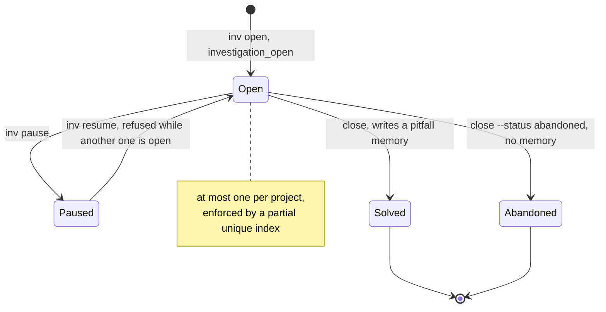
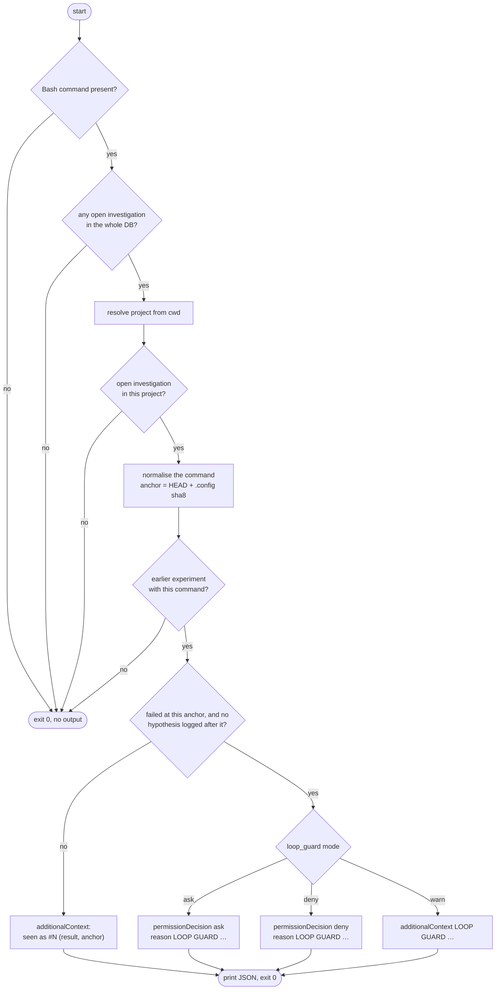
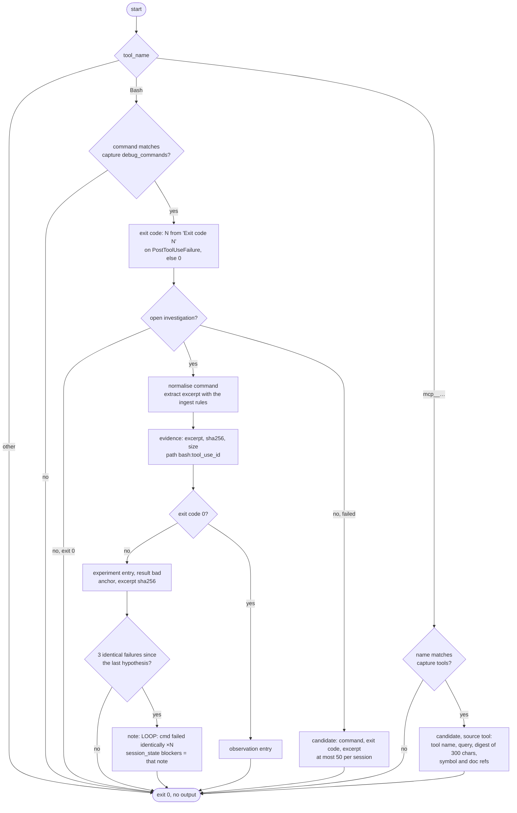

# Investigations

Board bring-up, kernel regressions and timing or fitter failures take days and many
Claude sessions, with several compactions per day. The failure mode seen in practice:
after a compaction the model loses the list of what was already ruled out and runs
experiments it already ran. That loop can go on for days.

The expensive knowledge is not the final fix but *what was already ruled out*, *under
which setup*, and *what evidence exists*. An investigation keeps that outside the
context window, puts it back after every compaction, and stops a repeated experiment
before it runs.

## Four layers against loops

Each layer works without relying on the model's discipline:

1. **Persistence.** Every experiment is a row with its normalised `command`, `anchor`
   (commit and `.config`, or bitstream / image id), `result` (`good`, `bad`,
   `inconclusive`) and the sha256 of its evidence excerpt. Nothing about the debug
   history depends on the context window.
2. **Re-injection.** The SessionStart hook (after `compact` or `resume`) always injects
   the full investigation block. The prompt hook injects it on the first prompt of a
   session and on every 20th prompt after that, and a one-line reminder plus any
   blocker in between.
3. **Loop guard (PreToolUse).** A Bash command identical to a failed experiment at the
   same anchor is stopped before it runs: Claude Code asks the user (or refuses, with
   `[loop_guard] mode = "deny"`).
4. **Loop detection (PostToolUse).** The third identical failure (same command, same
   output excerpt) adds a `LOOP:` note and makes it the session's blocker, shown on
   every prompt until a new hypothesis is logged.

## Lifecycle



- A project has at most one **open** investigation. This is a database rule (a
  partial unique index on `investigations(project) WHERE status = 'open'`), not only a
  check in the code, so two hooks cannot race past it. Any number can be **paused**.
- An investigation belongs to the project of the directory it was opened in. It
  records the clone it was opened in; the rendering says whether you are in that clone.
- Entries are append-only. A correction is a new entry (a `note`).
- Solved and abandoned investigations stay in the database: listed by `inv list`,
  searchable with `inv list --grep`, exportable with `inv export <id>`.

### What is recorded at open

`inv open` / `investigation_open` snapshots the *setup under test* into the
investigation's `env`:

- every `environment` memory of the project and its linked projects (`BOARD=de10-nano`,
  `QUARTUS=23.1`, `/dev/ttyUSB1=de10-nano-uart`, …; see `survivemem env`);
- the anchor of a present clone of each of those projects;
- optional free text (`--env` / `env`).

### Entries

| Kind | Meaning |
|---|---|
| `hypothesis` | a suspected cause. Logging one also *answers* the loop guard and clears loop blockers. |
| `experiment` | something run to test a hypothesis. Needs `command`; carries `result` and `anchor`. |
| `observation` | something seen: a log, a measurement, a successful debug command. |
| `ruled_out` | a cause that has been excluded, with a one-line reason and, ideally, evidence. |
| `note` | anything else. Notes starting with `LOOP: ` or `BLOCKER: ` are blockers. |

## The loop guard (PreToolUse)



The first check is one SQLite query with no `git` call, so the common case (no open
investigation anywhere) costs about 45 ms for the whole process.

When the guard trips, Claude Code shows the user a permission prompt with this reason
(the evidence name is the attached file, or `bash:<tool_use_id>` for output captured
by the PostToolUse hook):

```
LOOP GUARD: identical to experiment #6 (2026-10-31, result bad, evidence bash:toolu_01).
Log a new hypothesis or change the anchor before re-running.
```

The guard stops asking as soon as a `hypothesis` is logged after the failed
experiment, or when the anchor changes (a new commit, another `.config`, another
bitstream): the same command is then a new experiment, not a loop.

**`warn` and "seen as" never answer `allow`.** They only attach
`additionalContext` and set no permission decision. A hook that answers `allow`
skips the user's normal permission prompt for that command, and a memory tool must
never widen what Claude may run without asking. With no decision, Claude Code
applies your permission settings exactly as it would without survivemem.

Output for each case:

```json
{"hookSpecificOutput": {"hookEventName": "PreToolUse", "permissionDecision": "ask", "permissionDecisionReason": "LOOP GUARD: …"}}
{"hookSpecificOutput": {"hookEventName": "PreToolUse", "additionalContext": "seen as #6 (bad, anchor 96d0732+1f76)"}}
```

## Capture and loop detection (PostToolUse)

`PostToolUse` fires only for successful tool calls, and a successful Bash call's
`tool_response` (`stdout`, `stderr`, `interrupted`, `isImage`) carries no exit code. A
failed call arrives as `PostToolUseFailure`, whose `error` field reads
`Exit code N` followed by the output. That is why the same handler is registered for
both events ([`settings.json`](settings.json)).



- Only commands whose program name (per segment of the command line) fully matches
  `[capture] debug_commands` are captured (by default `bitbake`,
  `devtool`, `make`, `dmesg`, `journalctl`, `openocd`, `gdb`, the `quartus_*` tools,
  `jtagconfig`, `system-console`, `nios2-*`, `niosv*`, `bmaptool`, `dd`).
- With an open investigation, every matching command becomes evidence plus an entry:
  a failure is an `experiment` with `result = bad`, a success an `observation`. Only the
  excerpt (at most 1 000 characters, secrets redacted) is stored, never the full output.
- Without an investigation, only failures are kept, as candidates for
  `survivemem review`.
- MCP tools matching `[capture] tools` (by default jCodeMunch, RAG and jDocMunch tools)
  become candidates holding the tool name, the query and a digest of at most 300
  characters, with `symbol` / `doc` refs pulled from the result. The raw result is never
  stored.
- At most 50 candidates per session come from this hook; after that it logs once and
  stops writing.

**Loop detection.** When the same normalised command has failed with the same excerpt
three times, and no hypothesis was logged since, a note is appended. "Same excerpt" is
compared after removing what differs between two identical failures: dmesg timestamps,
bitbake `log.do_*`/`run.do_*` PIDs, `pid N`, long hex addresses and `/tmp` paths.

```
LOOP: make -j8 dtbs failed identically ×3 — #4, #5, #6
```

and the session's `blockers` in `session_state` are set to that line. From then on
every prompt shows it under `BLOCKER`, and the next compaction re-injects it. Logging
a new `hypothesis` answers it: the blocker disappears from the rendering, the prompt
hook removes it from `session_state`, and the loop guard lets the command through
(with a "seen as" note).

## Rendering

The same block is used by the prompt hook, the SessionStart hook, `investigation_status`
and `survivemem inv show`; it is at most 2 500 characters:

```
<survivemem-investigation>
INVESTIGATION 01M68MXAW3HW7RSCSKE2GEZQD0 "altera_uart probe fails"  status=open  since 2026-10-31  entries=7
SYMPTOM   no console on ttyS1 after boot; dmesg shows altera_uart probe failed with -517
SETUP     /dev/ttyUSB1=de10-nano-uart BOARD=de10-nano linux-de10@96d0732+1f76
CLONE     ~/w/linux-de10 @socfpga-6.6 (96d0732, .config 1f76…) · opened in this clone; 2 other clones exist
RULED OUT (1, last 40)
  - pinmux is fine: scope shows TX toggling  [#3, -]
OPEN HYPOTHESES (0)
LAST EXPERIMENTS (4)
  - #2 ?    make -j8 dtbs  anchor=96d0732+1f76
  - #4 bad  make -j8 dtbs  anchor=96d0732+1f76  evidence=bash:toolu_01
  - #5 bad  make -j8 dtbs  anchor=96d0732+1f76  evidence=bash:toolu_01
  - #6 bad  make -j8 dtbs  anchor=96d0732+1f76  evidence=bash:toolu_01
BLOCKER   LOOP: make -j8 dtbs failed identically ×3 — #4, #5, #6
DO NOT RE-RUN without a new hypothesis: make -j8 dtbs
</survivemem-investigation>
```

| Line | Content |
|---|---|
| `SETUP` | the environment snapshot taken at open |
| `CLONE` | the clone the investigation was opened in, and whether you are in it |
| `RULED OUT` | the last 40 `ruled_out` entries; older ones collapse to `(+N older)` |
| `OPEN HYPOTHESES` | hypotheses logged after the last `ruled_out` entry (last 10) |
| `LAST EXPERIMENTS` | the last 5 experiments with result, anchor and evidence |
| `BLOCKER` | the last `LOOP:` / `BLOCKER:` note not yet answered by a hypothesis |
| `NEXT` | `next` from the session's checkpoint, when present |
| `DO NOT RE-RUN` | commands of failed experiments at the current anchor not answered by a hypothesis (at most 10) |

When the block would exceed 2 500 characters, item texts shrink first, then
`LAST EXPERIMENTS` and `OPEN HYPOTHESES` are dropped, then the header lines shrink.
The `RULED OUT` list is cut only when nothing else is left, oldest first; the header
and the `DO NOT RE-RUN` footer always stay.

Between full renderings, the prompt hook prints one line (plus the blocker, if any):

```
investigation 01M68MXAW3HW7RSCSKE2GEZQD0 "altera_uart probe fails" open — call investigation_status for details
BLOCKER   LOOP: make -j8 dtbs failed identically ×3 — #4, #5, #6
```

After a compaction, SessionStart prints the full block first and ends its output with
`Call investigation_status before the next experiment.`

## Normalisation

Commands are compared after normalisation, on the whole string (not a prefix). The
same function is used when an experiment is logged, by the PostToolUse capture and by
the loop guard.

- Leading `cd … &&`, `sudo` (with its flags) and the `env` word (with its flags) are
  stripped, repeatedly. `VAR=value` assignments are kept: `MACHINE=qemuarm bitbake …` and
  `MACHINE=cyclone5 bitbake …` are different experiments.
- `2>&1` and trailing `| tee …`, `| head …`, `| tail …` are dropped.
- Timestamps (`2026-10-31`, `2026-10-31T09:33:34`, `20261031-0933`) are removed.
- The repository root is replaced by `$WS`, and `$HOME/` by `~/`.
- Whitespace is collapsed. Arguments and flags are kept.

| As run | Normalised |
|---|---|
| `cd ~/w/linux-de10 && make -j8 dtbs 2>&1 \| tail -20` | `make -j8 dtbs` |
| `sudo openocd -f board/de10.cfg \| tee /tmp/ocd-2026-10-31.log` | `openocd -f board/de10.cfg` |
| `ARCH=arm make -C /home/u/w/linux-de10 zImage` | `make -C $WS zImage` |

`survivemem inv loops` lists the commands with repeated failures and whether the guard
currently matches them, so false positives are visible.

## Anchors

An anchor says what an experiment ran against. For a git clone the default is
`<head sha>[+<first 8 hex of sha256(.config)>]`, taken from the current clone when an
experiment is logged or captured. The same command on the same commit with another
`.config` is a new experiment, not a loop. Pass `--anchor` (CLI) or `anchor` (MCP) for
anything else: a bitstream hash, an image build id.

`survivemem inv bisect` lists anchored experiments in order and, when there are both,
the last good and the first bad anchor after it: a manual bisect over commits,
bitstreams or images.

## Evidence

Files stay on disk; the database keeps a pointer, the sha256, the size, the tool and an
excerpt of at most 1 000 characters.

- `survivemem inv attach <file> [--tool T] [--no-copy]` copies the file to
  `<database directory>/evidence/<investigation id>/NNN-<name>` (unless `--no-copy`),
  hashes it and extracts an excerpt with the ingest rules (the tool is guessed from the
  file name when not given).
- `survivemem inv log … --evidence <file>` attaches a file and links it to the entry.
- The PostToolUse hook stores only an excerpt, with the path `bash:<tool_use_id>`.
- Each investigation may hold at most 200 MB of evidence (by recorded size).

## Closing

`inv close --root-cause "…" --fix "…"` (or `investigation_close`) requires both.

- `--status solved` (default) writes one `pitfall` memory:
  `<symptom> → root cause: <root cause> → fix: <fix>`, with the tag `investigation`,
  `source = investigation`, a `refs` pointer to the investigation and the current anchor.
  Because pitfalls are ranked first when a prompt looks like an error, the next time the
  symptom shows up the fix is injected.
- `--status abandoned` writes no memory: its "root cause" is a guess.

## Postmortem export

`survivemem inv export [<id>]` writes stand-alone Markdown for a tracker or wiki, in
this order: title, symptom, setup under test, timeline (seq, kind, result, text with
command, anchor), ruled out, root cause, fix, evidence (file, sha256, tool, size). It
needs no database to be read. Without an id it exports the open investigation.

```markdown
# altera_uart probe fails

Investigation `01M68MXAW3HW7RSCSKE2GEZQD0` · status **solved** · opened 2026-10-31T09:33:34Z · closed 2026-10-31T09:33:35Z

## Symptom
…
## Timeline

| # | kind | result | text | anchor |
|---|---|---|---|---|
| 4 | experiment | bad | make -j8 dtbs → exit 2 — `make -j8 dtbs` | 96d0732+1f76 |
…
```

## Log extraction (`ingest-log`)

Deterministic rules, one module per tool family. Each returns an excerpt (at most
1 000 characters, deduplicated, secrets redacted), the tool, tags and a suggested kind.
Nothing is stored above `candidate` or `evidence` without review.

| `--tool` | Extracts |
|---|---|
| `bitbake` (also `devtool`) | `ERROR:` lines, the failing task and recipe, the `log.do_*` path, up to 20 `\| ` lines from just before the first reported error |
| `make` (kernel builds) | the first compiler error with `file:line`, undefined references with their "in function" lines, Kconfig warnings, `modpost` errors, the last `make: ***` line |
| `dmesg` (also `journalctl`) | `Oops`, `BUG:`, `panic`, `WARNING: CPU:` with the next 15 lines, probe failures, `-EPROBE_DEFER` (error -517), `fpga_manager` / `fpga-region` / `fpga-bridge` messages |
| `quartus` | `Error (NNNNN)` and `Critical Warning (NNNNN)` with their ids as tags, Fitter "can't fit" and resource lines, worst-case setup/hold slack per clock, programmer errors with the cable, `jtagconfig` chain output (suggested as `environment`) |
| `openocd`, `system-console`, `gdb` | connection failures, JTAG chain errors, `Target not examined`, `Error:` lines, the last lines before exit |
| `other` | the tail of the log |

```sh
survivemem ingest-log output_files/top.fit.rpt --tool quartus
```

With an open investigation the file becomes evidence plus an `observation` entry;
otherwise the excerpt is stored as a candidate (`source = tool`). The PostToolUse hook
uses the same rules, choosing the tool from the command line (most specific first, since
`make` also appears inside other commands).

## Using it

### CLI

Without an id, every command acts on the open investigation of the current project
(or `--project X`).

```sh
survivemem inv open "altera_uart probe fails" --symptom "no console on ttyS1 after boot" [--env "SOF=top.sof@ab12"]
survivemem inv log hypothesis "uart clock not enabled before probe"
survivemem inv log experiment "rebuild the dtb with a clocks property" --command "make -j8 dtbs"
survivemem inv log ruled_out "pinmux is fine: scope shows TX toggling" --evidence scope.png
survivemem inv log experiment "new bitstream, probe still defers" --command 'quartus_pgm -m jtag -o "p;top.sof"' \
    --result bad --anchor sof:ab12cd34 --ref '{"type":"file","path":"output_files/top.sof"}'
survivemem inv attach dmesg-034.txt --tool dmesg
survivemem inv show [<id>] [--full]      # compact block, or the whole timeline
survivemem inv list [--status open|paused|solved|abandoned] [--grep TEXT] [--all]
survivemem inv bisect | loops [<id>]
survivemem inv pause | resume [<id>]
survivemem inv close --root-cause "…" --fix "…" [--status solved|abandoned]
survivemem inv export [<id>] > postmortem.md
```

`inv log` kinds: `hypothesis`, `experiment`, `observation`, `ruled_out`, `note`. An
experiment needs `--command`; `--result` is `good`, `bad` or `inconclusive`.

### MCP

| Tool | Access | What it does |
|---|---|---|
| `investigation_open(title, symptom, env?)` | write | open one for the current project; snapshots environment memories |
| `investigation_log(kind, text, command?, result?, anchor?, refs?)` | write | append an entry to the open investigation; `command` required for experiments |
| `investigation_status(id?)` | read | the rendering above, for the open one or the given id |
| `investigation_close(root_cause, fix, status="solved")` | write | close; solved writes the pitfall memory |

### Configuration

```toml
[loop_guard]
mode = "ask"     # ask: Claude Code asks the user; deny: refuse; warn: add context only

[capture]
# matched in full against the program name of each segment (a && b | c) of a command line
debug_commands = "bitbake|devtool|make|dmesg|journalctl|openocd|gdb|gdb-multiarch|[\\w.-]+-gdb|quartus_\\w+|jtagconfig|system-console|nios2-[\\w-]+|niosv[\\w-]*|bmaptool|dd"
# shell-style patterns matched against MCP tool names
tools = ["mcp__jcodemunch__*", "mcp__rag__*", "mcp__jdocmunch__*"]
```

## Rules for the model

These are carried by the MCP tool descriptions; repeating them in your `CLAUDE.md`
helps.

- At the start of any debugging task and after every compaction, call
  `investigation_status`. If none is open and the task is debugging (a symptom with an
  unknown cause), call `investigation_open` before the first experiment.
- Log every experiment *before* running it (`hypothesis`, then `experiment` with the
  planned `command`), and its outcome after. One entry per experiment, never a summary
  of several.
- Answer a loop-guard prompt by logging a new `hypothesis` that explains why the
  outcome should differ now (a changed anchor, a changed environment, new evidence), not
  by re-running.
- A `ruled_out` entry needs a one-line reason and, when available, evidence.
- While an investigation is open, reference its id in `checkpoint`'s `in_progress`.
