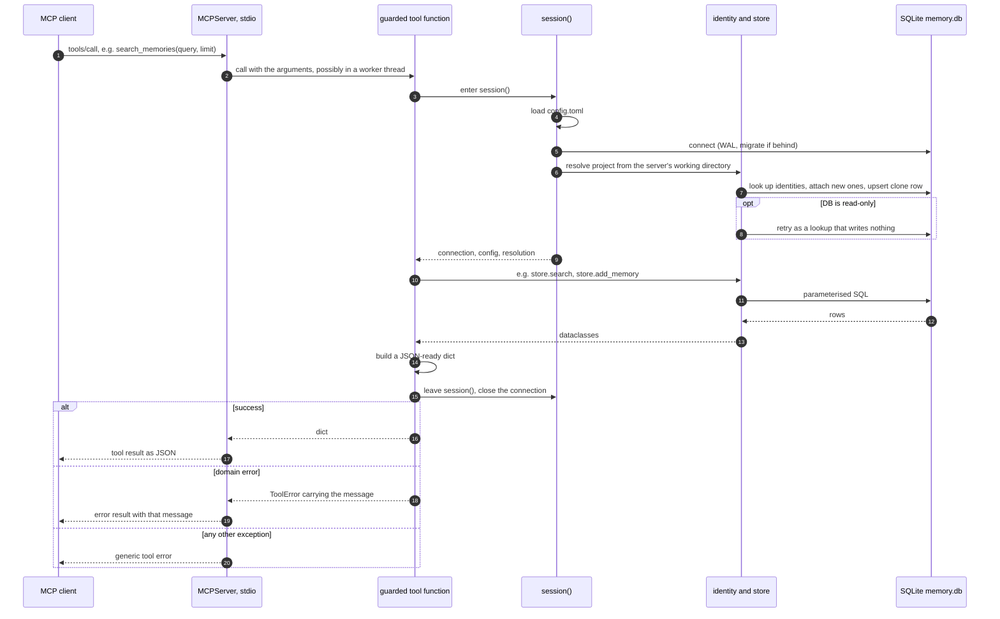

# MCP server

`survivemem serve` runs an MCP server over stdio. The project is resolved from the
server's working directory, which Claude Code sets to the directory you started it in.

## Claude Code

Installed with `uv tool install` (the `survivemem` binary is on `PATH`):

```sh
claude mcp add --transport stdio --scope user survivemem -- survivemem serve
```

Running from a source checkout:

```sh
claude mcp add --transport stdio --scope user survivemem -- \
    uv run --project /path/to/survivemem survivemem serve
```

Options (`--transport`, `--scope`, `--env`) go before the server name; the command
goes after `--`. User scope is stored in `~/.claude.json`. Check with `claude mcp list`.

## Claude Desktop

Add the server to `claude_desktop_config.json` under `mcpServers`:

```json
{
  "mcpServers": {
    "survivemem": {
      "command": "uv",
      "args": ["run", "--project", "/path/to/survivemem", "survivemem", "serve"]
    }
  }
}
```

Claude Desktop for Linux is in beta (Debian/Ubuntu packages). The location of
`claude_desktop_config.json` on Linux is not documented at the time of writing; open
the file from the app's developer settings rather than guessing a path. Desktop does
not start the server in a project directory, so memories land in the global scope
unless you pass `project` to the tools or set `SURVIVEMEM_PROJECT` in the server's
`env`.

## Tools

Every description starts with `READ.` or `WRITE.` and states its preconditions.

| Tool | Access | What it does |
|---|---|---|
| `list_projects()` | read | projects, counts, identities, checkouts; marks the current ones |
| `search_memories(query, project?, limit=8)` | read | relevance-ranked hits, never a full dump |
| `store_memory(content, kind, tags?, project?, scope?, refs?, anchor?, global_memory?)` | write | only when the user asked to remember or confirmed |
| `forget_memory(id)` | write | soft delete (`survivemem restore` undoes it) |
| `list_recent(limit=20)` | read | newest first, no candidates |
| `memory_status()` | read | DB path, counts per kind, FTS health |
| `checkpoint(goal, done, in_progress, next, decisions, files, blockers?)` | write | save this session's working state so it survives compaction ([compaction.md](compaction.md)) |
| `session_state()` | read | the current session's checkpoint and its rendering, or `{}` |
| `investigation_open(title, symptom, env?)` | write | open a debug investigation for the current project (one open at a time); snapshots its environment memories |
| `investigation_log(kind, text, command?, result?, anchor?, refs?)` | write | append a hypothesis, experiment, observation, ruled_out or note to the open investigation; `command` required for experiments |
| `investigation_status(id?)` | read | the compact investigation block: symptom, setup, ruled out, open hypotheses, last experiments, blocker, commands not to re-run |
| `investigation_close(root_cause, fix, status="solved")` | write | close the open investigation; `solved` writes one pitfall memory, `abandoned` none |

The four investigation tools act on the open investigation of the project resolved
from the server's working directory (`investigation_status` also accepts an id or a
unique prefix). Their descriptions carry the working rules for the model: call
`investigation_status` at the start of any debugging task and after every compaction,
open an investigation before the first experiment, log each experiment before running
it. See [investigations.md](investigations.md).

Errors from the store (unknown id, invalid kind, content that looks like a secret)
come back as tool errors carrying the message. The server logs to
`$XDG_STATE_HOME/survivemem/hooks.log`; stdout belongs to the protocol.

## An MCP tool call



Every tool function is wrapped by `guarded()`. *Domain errors* are the expected
failures: invalid input (`store.Invalid`: bad kind or scope, unknown ref type, content
that looks like a secret), an unknown id (`store.NotFound`), an ambiguous id prefix
(`store.Ambiguous`), database and config errors (`DBError`, `sqlite3.Error`,
`ConfigError`). They reach the client as tool errors with a readable message. Any other
exception is a bug and surfaces as a generic tool error.

Each call opens its own connection and resolves the project again, so the server
holds no state between calls and never shares a connection between threads. The cost
is one open and one schema check per call. On a read-only DB file, project resolution
falls back to a lookup that writes nothing, as in the hooks and the CLI: read tools
keep working, write tools fail with `attempt to write a readonly database`.

`search_memories` also embeds the query when vector search is enabled (the
`memory_vec` table exists, `sqlite-vec` loads and a loopback Ollama answers within
500 ms); otherwise it is FTS5 only. `store_memory` refuses `kind="candidate"`:
candidates come only from hooks.
